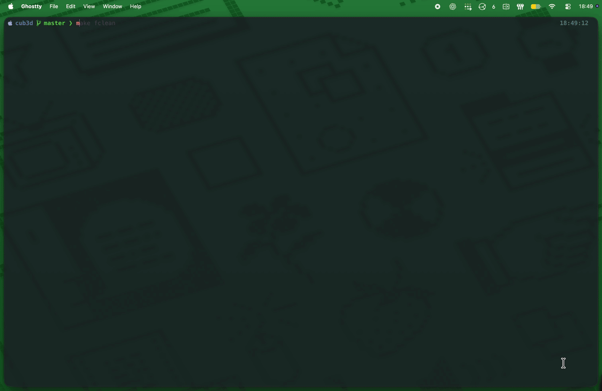
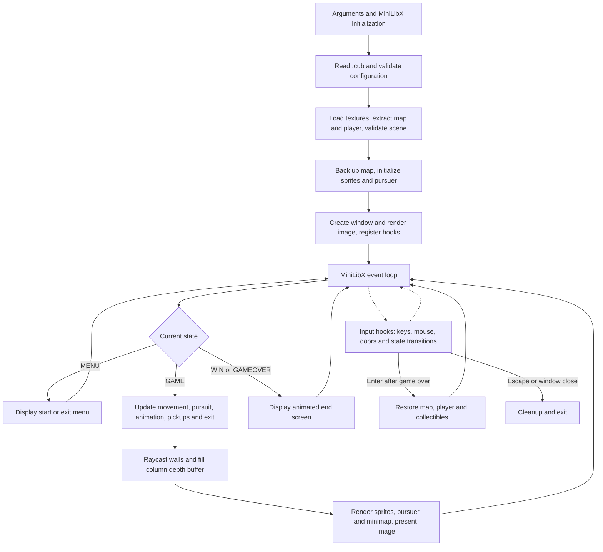
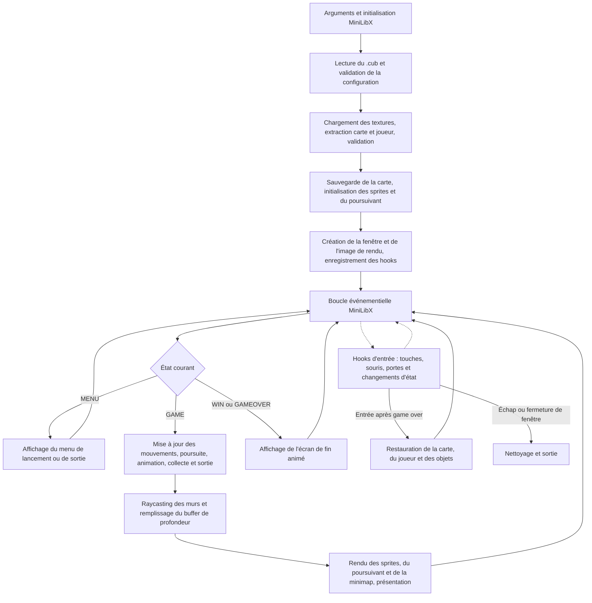

*Developed as part of the École 42 Paris curriculum.*

# Cub3D

**A raycasting engine in C powering a Slenderman-inspired exploration and horror game, with textured first-person rendering and interactive gameplay.**

[English](#english) | [Français](#francais)


---

<a id="english"></a>
## English

[Project Context](#en-context) · [Overview](#en-overview) · [Features](#en-features) · [Engineering Highlights](#en-engineering) · [Architecture](#en-architecture) · [Getting Started](#en-start) · [Usage Examples](#en-examples)

<a id="en-context"></a>
### 1. Project Context

Cub3D belongs to the École 42 Paris common core curriculum, a project-based, peer-learning programme. Its learning objectives include understanding raycasting, turning a two-dimensional map into a perspective view, applying geometry and trigonometry, and building a graphical application in C with several interdependent components.

The challenge is to implement the rendering mechanisms rather than use a complete game engine. MiniLibX supplies windows, images and event hooks; the project code computes ray intersections, perspective, texture coordinates, movement and sprite visibility. Parsing, graphical resources and game state must then work together throughout the application lifecycle.

Developed as a two-person project at 42 Paris, Cub3D involved a clear division of responsibilities. My teammate implemented the configuration and map parser, the minimap and a dedicated automated parsing and map-validation test suite. I developed the rest of the engine and gameplay: raycasting and DDA, wall projection and texture rendering, sprites, player movement and collisions, door interactions, collectibles, Slenderman mechanics, menus and game screens, as well as the overall module integration.

I also shaped the game's art direction through hand-crafted pixel art and visual assets created with Aseprite, giving the Slenderman-inspired experience its own visual identity. The [graphics resources](data/texture/) include wall and door textures, collectible, exit and pursuer sprites, menus and end screens.

<a id="en-overview"></a>
### 2. Overview

Cub3D is a raycasting engine built around a Slenderman-inspired exploration and horror game. Its main experience, [slenderman.cub](data/map/slenderman.cub), combines exploration, interactive doors and collectible gathering while a pursuer closes in. Collecting every item unlocks the exit; reaching it wins the game, while being caught triggers game over. A start menu and animated end screens frame the experience.

The engine creates a first-person view of a grid-based environment, following the raycasting approach associated with games such as *Wolfenstein 3D*. For each screen column, a ray crosses the 2D map until it reaches a wall or a closed door. The perpendicular hit distance determines the height of the textured column drawn on screen.

This implementation loads a `.cub` scene, initializes the player's position and camera, and renders a **1280 × 720** view with solid floor and ceiling colours. It also includes a player-centred minimap, interactive doors, animated collectible sprites, an unlockable exit and a Slenderman pursuer on maps that contain them.

The central engineering challenge is keeping **grid traversal**, **camera-space projection** and **mutable game state** consistent: opening a door affects both visibility and collisions, while the wall distances also determine which sprite columns may be displayed.

<a id="en-features"></a>
### 3. Features

| Area | Implemented scope |
|---|---|
| Scene loading | One `.cub` argument; six required configuration entries: `NO`, `SO`, `WE`, `EA`, `F`, `C`; XPM wall textures and RGB colours |
| Validation | Missing/duplicate configuration checks, RGB components in `[0,255]`, allowed map characters, exactly one player, door placement checks, flood fill from the spawn to detect leaks and unreachable collectibles |
| Camera & walls | Cell-centred `N`/`S`/`E`/`W` spawn; camera-plane rays, DDA traversal, perpendicular-distance projection, directional wall textures and a dedicated closed-door texture |
| Movement & input | Held-key forward/backward movement and strafing, arrow-key or horizontal-mouse rotation, axis-separated collisions against walls and closed doors |
| Minimap | Circular, scrolling overlay centred on the player; wall, floor, door and exit-state rendering |
| Doors & sprites | `E` toggles a door ahead; camera-facing collectible/exit sprites, collectible animation, far-to-near sprite ordering and wall-depth occlusion |
| Game progression | Proximity pickups, exit unlocked after all collectibles, direct Slenderman pursuit with collection-dependent speed, game-over restart |
| Window & lifecycle | Start/exit menu, animated win/game-over screens, Escape/window-close handlers, platform-specific mouse and cleanup code |

<a id="en-engineering"></a>
### 4. Engineering Highlights

#### Traversing the grid with camera-plane rays and DDA

A wall renderer needs the first obstacle along each viewing ray without testing every point in the world. `init_ray()` builds a ray from the player's direction and perpendicular camera plane:

```text
camera_x = 2 * x / W_WIDTH - 1
ray_dir  = player.dir + player.plane * camera_x
```

The direction starts as a unit cardinal vector and the plane has length `0.66`, giving a horizontal field of view of approximately `2 * atan(0.66)`, or 67°. `t_ray` stores the current grid cell, signed steps, reciprocal direction increments (`delta_dist_x/y`) and distances to the next grid boundaries (`side_dist_x/y`).

`perform_dda()` advances along the axis with the smaller boundary distance, adds that axis's delta, and records whether an X or Y boundary was crossed. It stops on `1` or `D`. This visits successive cells rather than sampling arbitrary small steps, and preserves the hit axis needed for projection and texture selection.

Sources: [ray structure](inc/struct/ray.h), [initial camera vectors](src/parsing/extract_player_data.c), [ray and boundary initialization](src/engine/raycasting/ray_init.c), [DDA traversal](src/engine/raycasting/ray_dda.c).

#### Projecting perpendicular depth into textured columns

Using the Euclidean ray length directly would make a flat wall appear curved near the screen edges. `calculate_wall_distance()` instead computes the ray parameter at the crossed grid boundary. With the unit direction and perpendicular plane used here, that parameter is the depth along the viewing direction:

```text
X-side hit: depth = (map_x - player.x + (1 - step_x) / 2) / ray_dir_x
column_height = (int)(W_HEIGHT / depth)
```

Y-side hits use the corresponding Y components. `raycasting()` centres the projected column vertically and clips its drawing range. `calculate_wall_x()` takes the fractional part of the hit coordinate along the wall, which becomes the horizontal texture coordinate. The hit axis and ray sign select the directional texture; `D` selects the door texture.

Vertical sampling uses `texture.height / line_height`, with an initial texture offset that accounts for clipping. `draw_wall_column()` fills the ceiling, textured wall and floor directly in `render_img`, using the image stride and bits per pixel supplied by MiniLibX. This separates ray geometry from pixel addressing and sampling.

Sources: [depth calculation](src/engine/raycasting/ray_dda.c), [wall hit coordinate](src/engine/raycasting/ray_init.c), [column projection and depth storage](src/engine/raycasting/raycasting.c), [texture selection and pixel writes](src/engine/raycasting/ray_render.c), [XPM loading](src/parsing/extract_config_utils.c).

#### Combining sprite projection with a one-dimensional depth buffer

Objects must scale with perspective while remaining hidden behind walls. The wall pass stores one perpendicular distance per screen column in `t_sprites.z_buffer`. `project_sprite()` subtracts the player's position, then applies the inverse of the camera basis formed by the plane and direction vectors. Camera-space depth (`transform_y`) determines both projected size and whether the sprite is in front of the camera.

`sort_sprites()` orders collectible and exit sprites from farthest to nearest using squared world distances. The renderer then draws only stripes whose camera-space depth is less than the corresponding wall depth. Texture pixels with a nonzero high transparency byte are skipped. This combines painter-style ordering between these sprites with column-level wall occlusion, without requiring a full per-pixel depth buffer.

Collectibles alternate between two frames using a loop counter; the exit selects its closed/open frame from the collection count. Slenderman has a separate projection/rendering pass after these sprites and uses the same wall-depth buffer; its supplied appearance uses one frame.

Sources: [sprite and projection structures](inc/struct/sprite.h), [buffer allocation and map extraction](src/engine/sprite/sprite_init.c), [sorting and inverse-camera projection](src/engine/sprite/sprite_utils.c), [stripe drawing and transparency](src/engine/sprite/sprite_render.c), [frame selection](src/engine/sprite/sprite_anim.c), [pursuer rendering](src/engine/slenderman/slender_render.c).

#### Keeping movement, rotation and door state in the same coordinate system

The player occupies continuous `double` coordinates, initialized at `(cell_x + 0.5, cell_y + 0.5)`, while collisions use integer map cells. `move_player()` advances along the direction vector and `strafe_player()` along the camera plane. Each checks X and Y separately before updating the position, allowing movement along a wall when only one axis is blocked.

`rotate_player()` applies the same 2D sine/cosine rotation matrix to both direction and plane, preserving their camera relationship. Key press/release hooks maintain `keys[]`; the game loop reads that state for sustained movement. The mouse callback converts horizontal displacement into an angle and recentres the pointer near the window edges.

`toggle_door()` checks the cell one direction-vector unit ahead and switches `D` to `d`, or back again. Raycasting and movement both treat only the uppercase form as blocking, so one map mutation updates rendering and collision behaviour together. Door interaction is a discrete state change rather than a sliding animation.

Sources: [player representation](inc/struct/player.h), [movement and rotation](src/engine/player_movement.c), [key state and dispatch](src/engine/key_handler.c), [Linux mouse input](src/engine/mouse_linux.c), [macOS mouse input](src/engine/mouse_macos.c), [door interaction](src/engine/door.c).

#### Validating scene data before entering the game loop

The parser separates configuration checks, resource extraction and map validation. `verif_textures()` tracks the six required identifiers before the map and rejects duplicates or missing entries. RGB parsing checks three comma-separated components in `[0,255]` and packs them as `(r << 16) | (g << 8) | b`; texture loading verifies the `.xpm` suffix before calling MiniLibX.

The map remains a `char **` grid. Validation checks the character set, exactly one cardinal spawn and the placement of doors between walls with traversable cells on the other axis. A recursive `flood_fill()` works on a duplicated map: `V` marks visited cells, reaching exterior/blank space records an error, and encountered collectibles are counted against the total. Doors are traversable during this check, since they can be opened during play.

The flood fill therefore validates the player's reachable region and collectible accessibility without consuming the live scene. In `main()`, a separate map backup preserves the initial layout; the mutable copy carries door and pickup changes and can be restored after game over.

Sources: [parsing entry point](src/parsing/parsing.c), [configuration identifiers](src/parsing/verif_file.c), [RGB parsing](src/parsing/extract_color.c), [configuration extraction](src/parsing/extract_config.c), [map extraction](src/parsing/extract_map_data.c), [door validation](src/parsing/verif_door.c), [flood fill and map checks](src/parsing/verif_map.c), [map backup](src/main.c), [restart](src/engine/reset_game.c).

#### Composing frames around explicit game states

The application must coordinate gameplay updates, rendering and window events without mixing menu actions with movement. `t_data` groups the shared state, while `t_state` selects `MENU`, `GAME`, `WIN` or `GAMEOVER`. MiniLibX hooks dispatch input and call `game_loop()` repeatedly; only the `GAME` branch updates the player, pursuer, sprite animation, pickups and exit condition.

`render_game()` draws walls, collectible/exit sprites, Slenderman and the minimap into a reusable image, then presents it with one `mlx_put_image_to_window()` call. The minimap converts nearby world tiles into player-relative screen positions and clips pixels to a circle. Menu and end states instead display their own images, with win/game-over frames selected by loop counters.

The pursuer moves along the normalized vector toward the player, checking each axis against walls and closed doors. Its speed interpolates from `0.015` to `0.04` map units per update as collectibles are gathered; a squared-distance threshold triggers game over. These are loop-based updates, not delta-time integration. Platform-selected cleanup handles images and the window, with display destruction additionally performed on Linux.

Sources: [shared state](inc/struct/data.h), [state enumeration](inc/struct/enum.h), [event registration and update loop](src/engine/game.c), [render composition](src/engine/render.c), [minimap projection](src/engine/minimap/minimap_utils.c), [pursuit movement](src/engine/slenderman/slender_move.c), [capture detection](src/engine/slenderman/slender_anim.c), [Linux cleanup](src/engine/cleanup_linux.c), [macOS cleanup](src/engine/cleanup_macos.c), [shared image destruction](src/engine/cleanup_linux_utils.c).

<a id="en-architecture"></a>
### 5. Architecture

The program is organized around **shared application state (`t_data`) and specialized rendering/update modules**. Parsing initializes MiniLibX resources as well as scene data; it is not a graphics-independent preprocessing stage. `t_player` holds camera vectors, `t_ray` is temporary per-column traversal state, `t_img` describes image memory, and `t_sprites` owns the sprite arrays and wall-depth buffer. `t_slenderman` and `t_minimap` hold the pursuer and overlay state.



The diagram shows successful startup and normal loop dispatch. Start enters `GAME`; collecting all items and reaching an exit selects `WIN`, while capture selects `GAMEOVER`. Enter restarts only from game over. Window closure and Escape use the same shutdown entry point.

```text
inc/game.h                 Engine interfaces and window dimensions
inc/parsing.h              Parsing interfaces and local utility declarations
inc/struct/                Application, camera, ray, image and gameplay types
inc/keybind/               Linux/macOS keycodes and event constants
inc/mlx_linux/             Bundled Linux MiniLibX header and static library
inc/mlx_macos/             Bundled macOS MiniLibX header and static library
src/main.c                 Startup, parsing, map backup and game initialization
src/parsing/               File reading, configuration, textures and scene validation
src/engine/                State loop, input, movement, doors, pickups, reset and cleanup
src/engine/raycasting/     Ray setup, DDA, depth calculation and wall drawing
src/engine/sprite/         Sprite creation, projection, sorting, animation and drawing
src/engine/slenderman/     Pursuer initialization, movement, capture and rendering
src/engine/minimap/        Circular overlay and player-relative tile drawing
src/libft/                 Local memory, string, conversion and line-reading helpers
data/map/                  Scenes, including good/ and bad/ parsing fixtures
data/texture/              Wall, door, sprite, menu and end-screen XPM assets
```

Sources: [startup](src/main.c), [shared types](inc/struct/data.h), [engine interfaces](inc/game.h), [parsing interfaces](inc/parsing.h).

<a id="en-start"></a>
### 6. Getting Started

**Requirements:** `cc` with GNU C17 support, Make, and a graphical desktop session. The [Makefile](Makefile) has explicit macOS (`Darwin`) and Linux-oriented branches and builds with `-Wall -Wextra -Werror -std=gnu17`.

| Platform | Graphics dependencies | MiniLibX configuration |
|---|---|---|
| macOS | Xcode Command Line Tools; OpenGL and AppKit frameworks | `inc/mlx_macos`; bundled archive is ARM64 (Apple Silicon) |
| Linux / X11 | C toolchain, X11, Xext, zlib and the math library; accessible X display | `inc/mlx_linux`; links `-lmlx -lXext -lX11 -lm -lz` |

MiniLibX headers and precompiled `libmlx.a` archives are included. `make` selects the platform directory automatically; it does not download or rebuild MiniLibX. The archive must match the target architecture. For example, an Intel Mac needs a matching MiniLibX archive in place of the supplied ARM64 one.

Install system prerequisites as appropriate:

```bash
# Debian / Ubuntu, with an X11 graphical session
sudo apt install build-essential libx11-dev libxext-dev zlib1g-dev

# macOS
xcode-select --install
```

From the repository root:

```bash
make                              # Build ./cub3d
./cub3d data/map/slenderman.cub     # Open the menu for the main game experience
```

Run from the repository root: scene texture paths and the additional menu, door and sprite asset paths are relative to the working directory. The executable requires exactly one scene argument. Press Enter on the default Start selection to enter the environment.

```bash
make clean      # Remove object files next to the sources
make fclean     # Also remove cub3d, tester_cub3D/ and .test_out
make re         # Full cleanup, then rebuild
make test       # Build, clone the external tester if absent, run its map script
```

`make test` requires Git, Bash and network access for the initial clone of the tester repository configured by `TESTER_URL` in the [Makefile](Makefile). After building the game, it clones `https://github.com/rmahrez19/tester_cub3D.git` into `tester_cub3D/` if that directory is absent, then runs `bash tester_cub3D/test_maps.sh`. The repository currently returns HTTP 404 for unauthenticated public access, so the initial clone depends on that repository being accessible to you. The normal `make` target already includes all gameplay modules; there is no separate bonus build target.

<a id="en-examples"></a>
### 7. Usage Examples

**Build and launch the Slenderman experience** — start the application, press Enter, then explore the environment and use the minimap to navigate.

```bash
make
./cub3d data/map/slenderman.cub
```

**Play the main scene** — [slenderman.cub](data/map/slenderman.cub) includes doors, collectibles, an exit and a pursuer. Approach collectible centres to pick them up, face a nearby door and press `E` to toggle it, then reach the exit after gathering every item. The pursuer accelerates as the collection progresses; after capture, Enter restores the initial scene and starts again.

**Explore an alternative map** — move through the corridors of [works.cub](data/map/good/works.cub) and compare the textured view with the minimap.

```bash
./cub3d data/map/good/works.cub
```

**Explore another layout** — [cheese_maze.cub](data/map/good/cheese_maze.cub) provides a maze with an exit and no collectibles or pursuer; the exit is therefore available immediately.

```bash
./cub3d data/map/good/cheese_maze.cub
```

| Context | Input | Action |
|---|---|---|
| Menu | `↑` / `↓` or `W` / `S` | Switch between Start and Exit |
| Menu | Enter | Confirm the selected option |
| Game | `W` / `S` | Move forward / backward |
| Game | `A` / `D` | Strafe left / right |
| Game | `←` / `→` | Rotate left / right |
| Game | Horizontal mouse movement | Rotate the view |
| Game | `E` | Open / close the door in the cell ahead |
| Game over | Enter | Restore the scene and restart |
| Any state | Escape or window close button | Exit |

**Read a scene configuration** — this header is taken from [works.cub](data/map/good/works.cub), with spacing normalized. The map follows the six configuration entries.

```text
WE data/texture/wall_west.xpm
NO data/texture/wall_north.xpm
SO data/texture/wall_south.xpm
F 17,38,64
EA data/texture/wall_east.xpm
C 218,234,235
```

In the map, `1` is a wall, `0` is floor, and exactly one `N`, `S`, `E` or `W` defines the player's spawn and orientation. Extended scenes use `D` for a closed door, `C` for a collectible, `X` for an exit and lowercase `s` for the pursuer. Lowercase `d` is the runtime open-door state, not an input-map symbol. `C` denotes ceiling colour in the header and a collectible inside the map.

---

<a id="francais"></a>
## Français

[Contexte du projet](#fr-contexte) · [Présentation](#fr-presentation) · [Fonctionnalités](#fr-fonctionnalites) · [Points techniques](#fr-technique) · [Architecture](#fr-architecture) · [Installation et lancement](#fr-installation) · [Exemples](#fr-exemples)

<a id="fr-contexte"></a>
### 1. Contexte du projet

Cub3D s'inscrit dans le tronc commun de l'École 42 Paris, une formation par projets et apprentissage entre pairs. Ses objectifs pédagogiques comprennent la compréhension du raycasting, la transformation d'une carte bidimensionnelle en vue en perspective, l'application de la géométrie et de la trigonométrie, ainsi que le développement d'une application graphique en C composée de plusieurs modules interdépendants.

Le défi consiste à implémenter les mécanismes de rendu plutôt qu'à utiliser un moteur de jeu complet. MiniLibX fournit les fenêtres, les images et les hooks d'événements ; le code du projet calcule les intersections des rayons, la perspective, les coordonnées de texture, les déplacements et la visibilité des sprites. Le parsing, les ressources graphiques et l'état du jeu doivent ensuite fonctionner ensemble tout au long du cycle de vie de l'application.

Développé en binôme à 42 Paris, Cub3D repose sur une répartition claire des responsabilités. Mon coéquipier a développé le parser de configuration et de cartes, la minimap et un testeur automatisé dédié au parsing et à la validation des cartes. J'ai développé le reste du moteur et du gameplay : raycasting et DDA, projection des murs et rendu des textures, sprites, déplacements et collisions du joueur, interactions avec les portes, collectibles, mécaniques de Slenderman, menus et écrans de jeu, ainsi que l'intégration générale des modules.

J'ai également réalisé la direction artistique du jeu à travers un travail de pixel art et de création d'éléments visuels à la main avec Aseprite, donnant à cette expérience inspirée de Slenderman sa propre identité visuelle. Les [ressources graphiques](data/texture/) comprennent des textures de murs et de portes, des sprites d'objets, de sortie et de poursuivant, des menus et des écrans de fin.

<a id="fr-presentation"></a>
### 2. Présentation

Cub3D est un moteur de raycasting construit autour d'un jeu d'exploration et d'horreur inspiré de Slenderman. Son expérience principale, [slenderman.cub](data/map/slenderman.cub), associe exploration, portes interactives et collecte d'objets sous la menace d'un poursuivant. Ramasser tous les objets déverrouille la sortie ; l'atteindre permet de gagner, tandis qu'une capture déclenche le game over. Un menu de lancement et des écrans de fin animés encadrent l'expérience.

Le moteur produit une vue à la première personne d'un environnement sur grille, selon l'approche du raycasting associée à des jeux comme *Wolfenstein 3D*. Pour chaque colonne de l'écran, un rayon traverse la carte 2D jusqu'à rencontrer un mur ou une porte fermée. La distance perpendiculaire à l'impact détermine la hauteur de la colonne texturée affichée.

Cette implémentation charge une scène `.cub`, initialise la position du joueur et sa caméra, puis affiche une vue de **1280 × 720** avec un sol et un plafond de couleur unie. Elle comprend également une minimap centrée sur le joueur, des portes interactives, des sprites animés à collecter, une sortie déverrouillable et un poursuivant Slenderman sur les cartes qui en contiennent.

La difficulté technique centrale est de maintenir la cohérence entre **parcours de grille**, **projection dans l'espace caméra** et **état mutable du jeu** : ouvrir une porte modifie à la fois la visibilité et les collisions, tandis que les distances des murs déterminent aussi quelles colonnes de sprites peuvent être affichées.

<a id="fr-fonctionnalites"></a>
### 3. Fonctionnalités

| Domaine | Périmètre implémenté |
|---|---|
| Chargement des scènes | Un argument `.cub` ; six entrées de configuration obligatoires : `NO`, `SO`, `WE`, `EA`, `F`, `C` ; textures murales XPM et couleurs RGB |
| Validation | Vérification des entrées manquantes/dupliquées, composantes RGB dans `[0,255]`, caractères de carte autorisés, joueur unique, placement des portes, flood fill depuis le spawn pour détecter les ouvertures et les objets inaccessibles |
| Caméra et murs | Spawn `N`/`S`/`E`/`W` au centre d'une case ; rayons issus du plan caméra, parcours DDA, projection par distance perpendiculaire, textures directionnelles et texture dédiée aux portes fermées |
| Déplacement et entrées | Avance/recul et strafe par touches maintenues, rotation aux flèches ou par mouvement horizontal de souris, collisions séparées par axe contre les murs et les portes fermées |
| Minimap | Overlay circulaire défilant, centré sur le joueur ; affichage des murs, du sol, des portes et de l'état de la sortie |
| Portes et sprites | Bascule d'une porte devant le joueur avec `E` ; sprites d'objets/sorties orientés vers la caméra, animation des objets, tri du plus éloigné au plus proche et occlusion par la profondeur des murs |
| Progression | Ramassage par proximité, sortie déverrouillée après collecte complète, poursuite directe par Slenderman avec vitesse liée à la collecte, redémarrage après un game over |
| Fenêtre et cycle de vie | Menu de lancement/sortie, écrans animés de victoire/game over, gestion d'Échap et de la fermeture de fenêtre, code souris et nettoyage propres à chaque plateforme |

<a id="fr-technique"></a>
### 4. Points techniques

#### Parcourir la grille avec des rayons issus du plan caméra et le DDA

Le rendu des murs doit trouver le premier obstacle sur chaque rayon de vision sans tester tous les points du monde. `init_ray()` construit un rayon à partir de la direction du joueur et du plan caméra perpendiculaire :

```text
camera_x = 2 * x / W_WIDTH - 1
ray_dir  = player.dir + player.plane * camera_x
```

La direction est initialisée comme un vecteur cardinal unitaire et le plan a une longueur de `0.66`, ce qui donne un champ de vision horizontal d'environ `2 * atan(0.66)`, soit 67°. `t_ray` conserve la case courante, les pas signés, les incréments inverses des composantes de direction (`delta_dist_x/y`) et les distances aux prochaines frontières de la grille (`side_dist_x/y`).

`perform_dda()` avance sur l'axe dont la frontière est la plus proche, ajoute le delta de cet axe et mémorise le franchissement d'une frontière X ou Y. Le parcours s'arrête sur `1` ou `D`. Il visite ainsi les cases successives plutôt que d'échantillonner le rayon avec un petit pas arbitraire, tout en conservant l'axe d'impact nécessaire à la projection et au choix de texture.

Sources : [structure des rayons](inc/struct/ray.h), [vecteurs initiaux de la caméra](src/parsing/extract_player_data.c), [initialisation des rayons et des frontières](src/engine/raycasting/ray_init.c), [parcours DDA](src/engine/raycasting/ray_dda.c).

#### Projeter la profondeur perpendiculaire en colonnes texturées

Utiliser directement la longueur euclidienne du rayon ferait paraître un mur plat courbé sur les bords de l'écran. `calculate_wall_distance()` calcule plutôt le paramètre du rayon à la frontière franchie. Avec la direction unitaire et le plan perpendiculaire utilisés ici, ce paramètre correspond à la profondeur selon la direction de vision :

```text
X-side hit: depth = (map_x - player.x + (1 - step_x) / 2) / ray_dir_x
column_height = (int)(W_HEIGHT / depth)
```

Les impacts sur une frontière Y utilisent les composantes Y correspondantes. `raycasting()` centre verticalement la colonne projetée et limite sa zone de dessin à l'écran. `calculate_wall_x()` extrait la partie fractionnaire de la coordonnée d'impact le long du mur, qui devient la coordonnée horizontale dans la texture. L'axe d'impact et le signe du rayon sélectionnent la texture directionnelle ; `D` sélectionne celle de la porte.

L'échantillonnage vertical utilise `texture.height / line_height`, avec un décalage initial qui tient compte du clipping. `draw_wall_column()` remplit le plafond, le mur texturé et le sol directement dans `render_img`, en utilisant le stride et les bits par pixel fournis par MiniLibX. La géométrie des rayons est ainsi séparée de l'adressage des pixels et de l'échantillonnage.

Sources : [calcul de profondeur](src/engine/raycasting/ray_dda.c), [coordonnée d'impact sur le mur](src/engine/raycasting/ray_init.c), [projection des colonnes et stockage de profondeur](src/engine/raycasting/raycasting.c), [choix des textures et écriture des pixels](src/engine/raycasting/ray_render.c), [chargement XPM](src/parsing/extract_config_utils.c).

#### Associer projection des sprites et buffer de profondeur unidimensionnel

Les objets doivent changer de taille avec la perspective tout en restant cachés derrière les murs. Le rendu des murs stocke une distance perpendiculaire par colonne d'écran dans `t_sprites.z_buffer`. `project_sprite()` soustrait la position du joueur, puis applique l'inverse de la base caméra formée par les vecteurs plan et direction. La profondeur dans l'espace caméra (`transform_y`) détermine la taille projetée et indique si le sprite se trouve devant la caméra.

`sort_sprites()` ordonne les objets à collecter et les sorties du plus éloigné au plus proche, à partir des distances au carré dans le monde. Le rendu ne dessine ensuite que les bandes dont la profondeur caméra est inférieure à celle du mur correspondant. Les pixels de texture dont l'octet de transparence de poids fort est non nul sont ignorés. Ce mécanisme combine un tri de type painter entre ces sprites et une occlusion par colonne contre les murs, sans buffer de profondeur complet par pixel.

Les objets alternent entre deux frames grâce à un compteur de boucle ; la sortie choisit sa frame fermée/ouverte selon le nombre d'objets ramassés. Slenderman possède une passe de projection/rendu distincte après ces sprites et utilise le même buffer de profondeur des murs ; son apparence fournie utilise une seule frame.

Sources : [structures de sprite et de projection](inc/struct/sprite.h), [allocation des buffers et extraction depuis la carte](src/engine/sprite/sprite_init.c), [tri et projection par l'inverse de la caméra](src/engine/sprite/sprite_utils.c), [dessin des bandes et transparence](src/engine/sprite/sprite_render.c), [sélection des frames](src/engine/sprite/sprite_anim.c), [rendu du poursuivant](src/engine/slenderman/slender_render.c).

#### Maintenir déplacements, rotation et portes dans le même repère

Le joueur possède des coordonnées continues en `double`, initialisées à `(cell_x + 0.5, cell_y + 0.5)`, tandis que les collisions utilisent les cases entières de la carte. `move_player()` avance selon le vecteur direction et `strafe_player()` selon le plan caméra. Chaque fonction vérifie X et Y séparément avant de mettre à jour la position, ce qui permet de longer un mur lorsqu'un seul axe est bloqué.

`rotate_player()` applique la même matrice de rotation 2D en sinus/cosinus à la direction et au plan, préservant leur relation géométrique. Les hooks de pression/relâchement maintiennent `keys[]` ; la boucle du jeu lit cet état pour prolonger le mouvement. Le callback souris convertit le déplacement horizontal en angle et recentre le pointeur à proximité des bords de la fenêtre.

`toggle_door()` examine la case située une unité de vecteur direction devant le joueur et remplace `D` par `d`, ou inversement. Le raycasting et les déplacements ne considèrent que la forme majuscule comme bloquante : une seule modification de la carte met donc à jour le rendu et les collisions. L'interaction est un changement d'état discret, pas une animation de porte coulissante.

Sources : [représentation du joueur](inc/struct/player.h), [déplacements et rotation](src/engine/player_movement.c), [état des touches et dispatch](src/engine/key_handler.c), [souris sous Linux](src/engine/mouse_linux.c), [souris sous macOS](src/engine/mouse_macos.c), [interaction avec les portes](src/engine/door.c).

#### Valider les données de scène avant d'entrer dans la boucle de jeu

Le parser sépare les vérifications de configuration, l'extraction des ressources et la validation de la carte. `verif_textures()` suit les six identifiants obligatoires avant la carte et rejette les doublons ou les entrées manquantes. Le parsing RGB vérifie trois composantes séparées par des virgules dans `[0,255]` et les encode par `(r << 16) | (g << 8) | b` ; le chargement des textures vérifie le suffixe `.xpm` avant d'appeler MiniLibX.

La carte reste une grille `char **`. La validation vérifie les caractères, la présence d'un unique spawn cardinal et le placement des portes entre des murs, avec des cases praticables sur l'autre axe. Un `flood_fill()` récursif travaille sur une copie : `V` marque les cases visitées, atteindre l'extérieur ou un espace vide signale une erreur, et le nombre d'objets rencontrés est comparé au total. Les portes sont franchissables pendant cette vérification puisqu'elles peuvent être ouvertes en jeu.

Le flood fill valide donc la région accessible depuis le joueur et l'accessibilité des objets sans modifier la scène utilisée en jeu. Dans `main()`, une sauvegarde distincte préserve la disposition initiale ; la copie mutable porte les changements des portes et de la collecte et peut être restaurée après un game over.

Sources : [entrée du parsing](src/parsing/parsing.c), [identifiants de configuration](src/parsing/verif_file.c), [parsing RGB](src/parsing/extract_color.c), [extraction de la configuration](src/parsing/extract_config.c), [extraction de la carte](src/parsing/extract_map_data.c), [validation des portes](src/parsing/verif_door.c), [flood fill et vérifications de carte](src/parsing/verif_map.c), [sauvegarde de la carte](src/main.c), [redémarrage](src/engine/reset_game.c).

#### Composer les frames autour d'états de jeu explicites

L'application doit coordonner mises à jour du jeu, rendu et événements de fenêtre sans confondre les actions du menu avec les déplacements. `t_data` regroupe l'état partagé, tandis que `t_state` sélectionne `MENU`, `GAME`, `WIN` ou `GAMEOVER`. Les hooks MiniLibX distribuent les entrées et appellent `game_loop()` de façon répétée ; seule la branche `GAME` met à jour le joueur, le poursuivant, l'animation des sprites, la collecte et la condition de sortie.

`render_game()` dessine les murs, les sprites d'objets/sorties, Slenderman et la minimap dans une image réutilisée, puis la présente avec un appel à `mlx_put_image_to_window()`. La minimap convertit les cases voisines en positions écran relatives au joueur et limite les pixels à un cercle. Le menu et les états de fin affichent leurs propres images, les frames de victoire/game over étant sélectionnées par des compteurs de boucle.

Le poursuivant avance selon le vecteur normalisé dirigé vers le joueur, en vérifiant chaque axe contre les murs et les portes fermées. Sa vitesse est interpolée de `0.015` à `0.04` unité de carte par mise à jour au fil de la collecte ; un seuil de distance au carré déclenche le game over. Ces mises à jour dépendent de la boucle, pas d'une intégration par delta time. Le nettoyage sélectionné selon la plateforme traite les images et la fenêtre, avec destruction supplémentaire de la connexion d'affichage sous Linux.

Sources : [état partagé](inc/struct/data.h), [énumération des états](inc/struct/enum.h), [enregistrement des événements et boucle de mise à jour](src/engine/game.c), [composition du rendu](src/engine/render.c), [projection de la minimap](src/engine/minimap/minimap_utils.c), [déplacement du poursuivant](src/engine/slenderman/slender_move.c), [détection de capture](src/engine/slenderman/slender_anim.c), [nettoyage Linux](src/engine/cleanup_linux.c), [nettoyage macOS](src/engine/cleanup_macos.c), [destruction partagée des images](src/engine/cleanup_linux_utils.c).

<a id="fr-architecture"></a>
### 5. Architecture

Le programme s'organise autour d'un **état applicatif partagé (`t_data`) et de modules spécialisés de rendu/mise à jour**. Le parsing initialise des ressources MiniLibX en plus des données de scène : ce n'est pas une étape de prétraitement indépendante du système graphique. `t_player` conserve les vecteurs caméra, `t_ray` est l'état temporaire de parcours d'une colonne, `t_img` décrit la mémoire d'une image et `t_sprites` possède les tableaux de sprites et le buffer de profondeur des murs. `t_slenderman` et `t_minimap` contiennent l'état du poursuivant et de l'overlay.



Le diagramme décrit un démarrage réussi et le dispatch normal de la boucle. Start active `GAME` ; ramasser tous les objets et atteindre une sortie sélectionne `WIN`, tandis qu'une capture sélectionne `GAMEOVER`. Entrée ne redémarre la partie que depuis le game over. La fermeture de fenêtre et Échap utilisent le même point d'entrée de nettoyage.

```text
inc/game.h                 Interfaces du moteur et dimensions de la fenêtre
inc/parsing.h              Interfaces du parsing et déclarations des utilitaires locaux
inc/struct/                Types applicatifs, caméra, rayons, images et gameplay
inc/keybind/               Keycodes Linux/macOS et constantes d'événements
inc/mlx_linux/             Header et bibliothèque statique MiniLibX Linux fournis
inc/mlx_macos/             Header et bibliothèque statique MiniLibX macOS fournis
src/main.c                 Démarrage, parsing, sauvegarde de carte et initialisation du jeu
src/parsing/               Lecture, configuration, textures et validation de scène
src/engine/                États, entrées, mouvements, portes, collecte, reset et nettoyage
src/engine/raycasting/     Initialisation des rayons, DDA, profondeur et dessin des murs
src/engine/sprite/         Création, projection, tri, animation et dessin des sprites
src/engine/slenderman/     Initialisation, mouvement, capture et rendu du poursuivant
src/engine/minimap/        Overlay circulaire et dessin des cases relatif au joueur
src/libft/                 Helpers mémoire, chaînes, conversions et lecture de lignes
data/map/                  Scènes, dont les cas de parsing good/ et bad/
data/texture/              Assets XPM des murs, portes, sprites, menus et écrans de fin
```

Sources : [démarrage](src/main.c), [types partagés](inc/struct/data.h), [interfaces du moteur](inc/game.h), [interfaces du parsing](inc/parsing.h).

<a id="fr-installation"></a>
### 6. Installation et lancement

**Prérequis :** `cc` avec prise en charge de GNU C17, Make et une session graphique. Le [Makefile](Makefile) comporte des branches explicites pour macOS (`Darwin`) et pour Linux, et compile avec `-Wall -Wextra -Werror -std=gnu17`.

| Plateforme | Dépendances graphiques | Configuration MiniLibX |
|---|---|---|
| macOS | Xcode Command Line Tools ; frameworks OpenGL et AppKit | `inc/mlx_macos` ; archive fournie en ARM64 (Apple Silicon) |
| Linux / X11 | Outils de compilation C, X11, Xext, zlib et bibliothèque mathématique ; affichage X accessible | `inc/mlx_linux` ; édition de liens avec `-lmlx -lXext -lX11 -lm -lz` |

Les headers MiniLibX et les archives précompilées `libmlx.a` sont inclus. `make` sélectionne automatiquement le dossier de la plateforme ; il ne télécharge ni ne recompile MiniLibX. L'archive doit correspondre à l'architecture cible. Un Mac Intel nécessite par exemple une archive MiniLibX adaptée à la place de celle fournie en ARM64.

Installez les prérequis système adaptés :

```bash
# Debian / Ubuntu, avec une session graphique X11
sudo apt install build-essential libx11-dev libxext-dev zlib1g-dev

# macOS
xcode-select --install
```

Depuis la racine du dépôt :

```bash
make                              # Compiler ./cub3d
./cub3d data/map/slenderman.cub     # Ouvrir le menu de l'expérience principale
```

Lancez le programme depuis la racine : les chemins des textures de scène et ceux des assets supplémentaires de menu, de porte et de sprites sont relatifs au répertoire courant. L'exécutable attend exactement un argument de scène. Appuyez sur Entrée avec la sélection Start par défaut pour entrer dans l'environnement.

```bash
make clean      # Supprimer les objets à côté des sources
make fclean     # Supprimer aussi cub3d, tester_cub3D/ et .test_out
make re         # Nettoyage complet, puis recompilation
make test       # Compiler, cloner le testeur externe si absent et lancer son script de cartes
```

`make test` nécessite Git, Bash et un accès réseau pour le clonage initial du dépôt du testeur configuré par `TESTER_URL` dans le [Makefile](Makefile). Après compilation du jeu, la cible clone `https://github.com/rmahrez19/tester_cub3D.git` dans `tester_cub3D/` si ce dossier est absent, puis exécute `bash tester_cub3D/test_maps.sh`. Le dépôt renvoie actuellement une erreur HTTP 404 en accès public non authentifié ; le clonage initial nécessite donc de disposer d'un accès au dépôt. La cible `make` normale inclut déjà tous les modules de gameplay ; il n'existe pas de cible de compilation bonus séparée.

<a id="fr-exemples"></a>
### 7. Exemples d'utilisation

**Compiler et lancer l'expérience Slenderman** — lancez l'application, appuyez sur Entrée, puis explorez l'environnement en vous orientant grâce à la minimap.

```bash
make
./cub3d data/map/slenderman.cub
```

**Jouer à la scène principale** — [slenderman.cub](data/map/slenderman.cub) contient des portes, des objets à collecter, une sortie et un poursuivant. Approchez-vous du centre des objets pour les ramasser, placez-vous face à une porte proche et appuyez sur `E` pour changer son état, puis rejoignez la sortie après avoir tout collecté. Le poursuivant accélère au fil de la collecte ; après une capture, Entrée restaure la scène initiale et relance la partie.

**Explorer une carte alternative** — parcourez les couloirs de [works.cub](data/map/good/works.cub) en comparant la vue texturée et la minimap.

```bash
./cub3d data/map/good/works.cub
```

**Explorer une autre disposition** — [cheese_maze.cub](data/map/good/cheese_maze.cub) propose un labyrinthe avec une sortie, sans objets à collecter ni poursuivant ; la sortie est donc disponible immédiatement.

```bash
./cub3d data/map/good/cheese_maze.cub
```

| Contexte | Entrée | Action |
|---|---|---|
| Menu | `↑` / `↓` ou `W` / `S` | Basculer entre Start et Exit |
| Menu | Entrée | Confirmer l'option sélectionnée |
| Jeu | `W` / `S` | Avancer / reculer |
| Jeu | `A` / `D` | Strafe gauche / droite |
| Jeu | `←` / `→` | Tourner à gauche / à droite |
| Jeu | Mouvement horizontal de souris | Orienter la vue |
| Jeu | `E` | Ouvrir / fermer la porte dans la case devant le joueur |
| Game over | Entrée | Restaurer la scène et recommencer |
| Tout état | Échap ou bouton de fermeture | Quitter |

**Lire une configuration de scène** — cet en-tête provient de [works.cub](data/map/good/works.cub), avec les espacements normalisés. La carte suit les six entrées de configuration.

```text
WE data/texture/wall_west.xpm
NO data/texture/wall_north.xpm
SO data/texture/wall_south.xpm
F 17,38,64
EA data/texture/wall_east.xpm
C 218,234,235
```

Dans la carte, `1` est un mur, `0` du sol et un unique `N`, `S`, `E` ou `W` définit le spawn et l'orientation du joueur. Les scènes étendues utilisent `D` pour une porte fermée, `C` pour un objet à collecter, `X` pour une sortie et `s` minuscule pour le poursuivant. `d` minuscule est l'état d'une porte ouverte à l'exécution, pas un symbole accepté dans la carte d'entrée. `C` désigne la couleur du plafond dans l'en-tête et un objet à collecter dans la carte.
